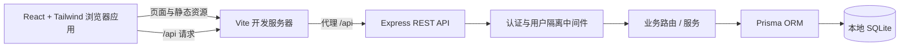
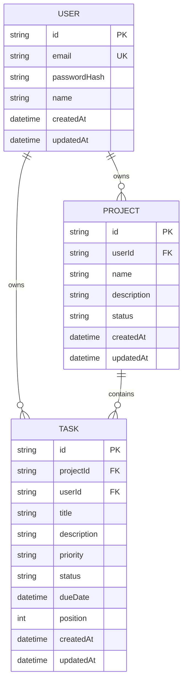

# TaskPilot 架构说明

## 总体架构

TaskPilot 使用 npm workspaces 管理一个前后端分离的 TypeScript monorepo。开发时浏览器访问 Vite，Vite 将 `/api` 请求代理到 Express；API 通过 Prisma 访问本地 SQLite 文件。无需付费第三方 API 或云服务即可开发和运行。



生产部署可以分别托管静态前端和 Node.js API，也可以由同一站点反向代理 `/api`。第一阶段以本地单机开发为目标。

## 目录结构

```text
apps/
  api/
    prisma/              Prisma schema、迁移与演示数据 seed
    src/
      routes/            Express 路由入口与认证、项目、任务路由
      middleware/        JWT 身份校验中间件
      lib/               Prisma Client 单例
      app.ts              Express 应用与中间件
      index.ts            API 进程入口
    .env.example          本地环境变量模板
  web/
    src/                  React 页面、Tailwind 样式与 Vitest 测试
    tests/e2e/             Playwright 浏览器测试
    vite.config.ts         Vite、Tailwind 和 API 开发代理
ARCHITECTURE.md
DEVELOPMENT_PLAN.md
README.md
package.json              npm workspaces 与根目录命令
```

前后端通过 `/api` HTTP 接口协作，不共享运行时模型。将来若需要共享 DTO 或校验规则，可在根目录增加 `packages/shared`，并由双方显式依赖。

## 数据库模型

Prisma schema 位于 `apps/api/prisma/schema.prisma`。所有模型使用 CUID 主键和创建/更新时间。User 是业务数据的归属者；Project 属于一个 User，Task 同时关联所属 User 和 Project。



| 模型 | 关键约束与字段 |
| --- | --- |
| `User` | `email` 唯一；仅存 `passwordHash`，不存密码明文。 |
| `Project` | `userId` 指向拥有者；`status` 当前约定为 `active` / `archived`。 |
| `Task` | `projectId` 与 `userId` 都必填；优先级为 `low` / `medium` / `high`，状态为 `todo` / `in_progress` / `done`。包含可空 `dueDate` 和整数 `position`。 |

SQLite 没有 Prisma 原生 enum 支持，因此状态和优先级以 `String` 保存，并由 API 输入校验保证取值。Project 暴露 `(id, userId)` 复合唯一键，Task 通过 `(projectId, userId)` 外键指向它，避免任务归属用户与项目拥有者不一致；外键删除使用级联策略。

### 用户数据隔离

- JWT 校验后只从可信 token subject 取得当前 `userId`，忽略请求体或查询参数中声称的用户 ID。
- 用户拥有的 Project 查询始终带 `userId` 条件；Task 查询同时带 `userId`，需要项目上下文时也验证项目属于同一用户。
- 创建 Task 时服务端从已授权项目推导 `userId`，不接受客户端决定归属。
- 资源不存在或归属其他用户时统一返回 404，避免暴露其他用户数据是否存在。
- 复合外键提供额外的数据完整性约束；业务查询仍需显式按用户过滤。

## REST API 规划

所有接口使用 `/api` 前缀，成功响应返回 JSON，认证接口除外的业务端点均要求 `Authorization: Bearer <access-token>`。

| 方法 | 路径 | 用途 | 阶段 |
| --- | --- | --- | --- |
| `GET` | `/api/health` | API 健康检查 | 已搭建 |
| `POST` | `/api/auth/register` | 注册账号并返回安全用户资料 | 已实现 |
| `POST` | `/api/auth/login` | 校验密码并签发访问令牌 | 已实现 |
| `POST` | `/api/auth/logout` | 验证令牌，通知前端清除本地令牌 | 已实现 |
| `GET` | `/api/auth/me` | 返回当前用户资料 | 已实现 |
| `PATCH` | `/api/auth/me` | 更新当前用户姓名 | 已实现 |
| `GET` | `/api/projects` | 列出当前用户项目，可按状态过滤 | 项目阶段 |
| `POST` | `/api/projects` | 创建项目 | 项目阶段 |
| `GET` | `/api/projects/:projectId` | 获取项目及可选任务摘要 | 项目阶段 |
| `PATCH` | `/api/projects/:projectId` | 更新名称、描述或状态 | 项目阶段 |
| `DELETE` | `/api/projects/:projectId` | 删除项目及其任务 | 项目阶段 |
| `GET` | `/api/projects/:projectId/tasks` | 列出指定项目任务，支持状态/优先级/日期过滤 | 任务阶段 |
| `POST` | `/api/projects/:projectId/tasks` | 在项目中创建任务 | 任务阶段 |
| `GET` | `/api/tasks/:taskId` | 获取当前用户任务 | 任务阶段 |
| `PATCH` | `/api/tasks/:taskId` | 更新任务字段或状态 | 任务阶段 |
| `DELETE` | `/api/tasks/:taskId` | 删除任务 | 任务阶段 |
| `PATCH` | `/api/projects/:projectId/tasks/reorder` | 保存项目内任务排序 | 任务阶段 |

认证请求使用 Zod 校验。项目和任务路由目前没有业务端点，但路由级 JWT 中间件已启用，后续新增端点会默认拒绝未认证请求。

## 鉴权和密码方案

- 注册时使用 `bcryptjs` 对密码做 bcrypt 哈希（cost factor 12），只将结果存入 `User.passwordHash`。登录使用 bcrypt compare，绝不返回哈希。
- 登录成功后用 `jsonwebtoken` 签发 1 小时访问 JWT，subject 和 `userId` claim 为 User ID，并包含 `email`；签名密钥通过环境变量 `JWT_SECRET` 注入。生产环境缺少密钥时 API 拒绝启动。
- Web 将 Bearer 访问令牌保存在 `localStorage`，页面启动时调用 `/api/auth/me` 恢复用户；纯 Bearer 退出由客户端删除令牌，服务端不维护令牌撤销表。
- API 允许来自 `http://localhost:5173` 的跨域请求，并响应带凭据的 CORS 配置；Web 使用 `credentials: include` 发送请求，但当前认证仍只使用 Bearer token。
- 初期 API 使用 Bearer token。后续若增加 refresh token，应使用随机高熵值并只保存其哈希，设置轮换、过期和撤销策略。
- 认证中间件负责解析 JWT 并向请求上下文附加可信用户 ID；权限检查必须在每个资源读取和写入路径执行。
- 当前 Web 使用 `localStorage` 保存访问令牌；生产部署应配置严格的 CSP 并持续防护 XSS。若改为 HttpOnly Cookie，需要同时设置 Secure、SameSite 和 CSRF 防护。

## 功能实现顺序

1. 认证：注册、登录、JWT 中间件、当前用户接口和权限测试。
2. 项目管理：按用户隔离的项目 CRUD、归档与删除行为。
3. 任务管理：任务 CRUD、状态/优先级校验、截止日期与排序。
4. Web 工作台：认证表单、项目列表、任务列表及加载/空/错误状态。
5. 交互增强：筛选、拖动排序、响应式体验、无障碍细节。
6. 加固与发布准备：输入校验、限流、安全头、迁移策略、备份说明和端到端验收。
