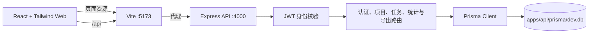
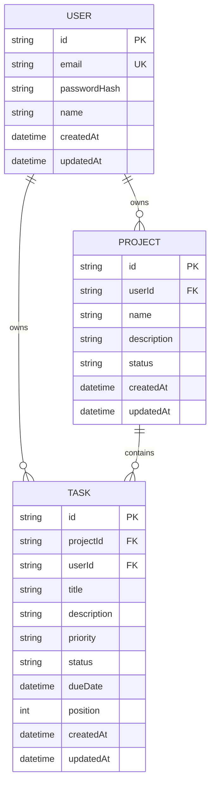

# TaskPilot 架构说明

## 系统结构

TaskPilot 是由 npm workspaces 管理的 TypeScript monorepo。浏览器加载 Vite 提供的 React 应用，并通过 `/api` 请求访问 Express API；API 通过 Prisma Client 读写 SQLite。开发模式下 Vite 将 `/api` 代理到本地 API。



开发时可用 `npm run dev` 同时启动前后端。Vite 配置了严格端口 `5173`，API 默认端口为 `4000`，可通过 `PORT` 修改 API 端口。API CORS 默认允许 `http://localhost:5173`，并可通过 `CORS_ORIGIN` 增加逗号分隔的来源。

## 代码目录

```text
apps/
  api/
    prisma/
      schema.prisma          User、Project、Task 数据模型
      migrations/            初始 SQLite migration
      seed.ts                 演示账号、项目和任务
    src/
      routes/                 health、auth、projects、tasks、dashboard、export
      middleware/auth.ts      JWT 签发和身份校验
      lib/prisma.ts           Prisma Client 单例
      app.ts                  Express、中间件和路由挂载
      index.ts                API 进程入口及密钥检查
  web/
    src/
      auth/                   前端登录态
      components/             页面共享布局和对话框
      lib/                    API 客户端
      pages/                  项目列表、任务看板、仪表盘
    tests/e2e/                Playwright 浏览器冒烟测试
    vite.config.ts            Vite、Tailwind 和 API 代理
README.md
ARCHITECTURE.md
TEST_REPORT.md
DELIVERY_REPORT.md
package.json                 npm workspaces 与根目录命令
```

前后端只通过 HTTP/JSON API 通信，不共享运行时模型。SQLite 文件路径由 `apps/api/prisma/schema.prisma` 中的 `file:./dev.db` 决定。

## 数据模型

Prisma schema 位于 `apps/api/prisma/schema.prisma`。三个模型均使用 CUID 主键和创建/更新时间。



| 模型 | 约束与行为 |
| --- | --- |
| `User` | `email` 唯一；只保存 bcrypt `passwordHash`，不保存密码明文。 |
| `Project` | 归属一个 `User`；状态约定为 `active` 或 `archived`；按 `(id, userId)` 暴露复合唯一键。 |
| `Task` | 同时关联 `Project` 和 `User`；`(projectId, userId)` 复合外键确保项目与任务属于同一用户；含优先级、状态、可空截止日期和看板位置。 |

SQLite 没有 Prisma 原生 enum 支持，因此状态和优先级以字符串存储，由 API 的 Zod schema 校验。任务状态为 `todo`、`in_progress`、`done`；优先级为 `low`、`medium`、`high`。用户、项目及任务关系均使用级联删除。

## API 路由

业务接口挂载在 `/api` 下。除健康检查、注册和登录外，认证、项目、任务、统计和导出接口都要求 `Authorization: Bearer <token>`。

| 方法 | 路径 | 认证 | 行为 |
| --- | --- | --- | --- |
| `GET` | `/api/health` | 否 | 返回 API 健康状态。 |
| `POST` | `/api/auth/register` | 否 | 校验资料、哈希密码并创建账号。 |
| `POST` | `/api/auth/login` | 否 | 校验密码并返回 JWT 和公开用户资料。 |
| `POST` | `/api/auth/logout` | 是 | 验证令牌并返回 `204`；客户端清除本地令牌。 |
| `GET` / `PATCH` | `/api/auth/me` | 是 | 读取当前用户资料或更新姓名。 |
| `GET` / `POST` | `/api/projects` | 是 | 列出本人项目或创建项目；列表可按状态过滤。 |
| `GET` / `PATCH` / `DELETE` | `/api/projects/:projectId` | 是 | 读取、更新或删除本人项目。 |
| `GET` / `POST` | `/api/projects/:projectId/tasks` | 是 | 列出或创建本人项目中的任务。列表支持 `status`、`priority`、`q` 和 `sort`。 |
| `GET` / `PATCH` / `DELETE` | `/api/tasks/:taskId` | 是 | 读取、更新或删除本人任务。 |
| `PATCH` | `/api/tasks/:taskId/status` | 是 | 更新任务状态和看板位置。 |
| `GET` | `/api/dashboard/stats` | 是 | 返回任务数、完成数、逾期数、完成率及状态/优先级分布；可传本人 `projectId`。 |
| `GET` | `/api/export/tasks.csv` | 是 | 导出当前用户的全部任务及项目名。 |

输入由 Zod 校验。项目和任务的读写始终包含当前 `userId` 条件；未找到或属于其他用户的资源统一返回 `404`，避免泄露资源存在性。创建任务时服务端根据已授权项目确定归属用户。

## 认证和数据安全

- 注册密码使用 `bcryptjs` cost factor 12 哈希；密码不会出现在 API 响应中。
- API 使用 HS256 JWT，包含 `userId`、`email` 和 `sub`，有效期为一小时。签名密钥来自 `JWT_SECRET`；密钥少于 32 个字符会被拒绝。生产模式没有设置密钥时 API 不会启动；开发模式可使用代码中的本地开发密钥。
- Web 将令牌存入 `localStorage` 的 `taskpilot.accessToken`，刷新页面时通过 `/api/auth/me` 恢复登录态。当前为无状态 Bearer token：服务端不维护撤销表，退出时由客户端删除令牌。
- API 对跨域请求校验来源；默认允许本地 Vite 地址，可通过 `CORS_ORIGIN` 配置额外来源。
- `apps/api/.env`、SQLite 数据库文件、依赖和构建产物由 `.gitignore` 排除；`.env.example` 作为模板保留在仓库。

`localStorage` 令牌方案适合本地演示。生产部署还需根据目标环境配置 HTTPS、严格 CSP 和 XSS 防护；当前代码尚未实现生产级速率限制、安全响应头或数据库备份流程。

## Web 页面和测试边界

- `/login`、`/register`：认证页面。
- `/projects`：项目列表及项目创建、编辑、归档和删除。
- `/projects/:projectId`：三列任务看板，可创建/编辑/删除任务，拖动改变状态和位置，并筛选、搜索和排序。
- `/dashboard`：任务统计、状态和优先级分布图表，以及 CSV 下载入口。
- Vitest API 测试通过 Supertest 调用 Express 应用，并用 Prisma/SQLite 验证认证、项目任务隔离及统计导出；Web Vitest 使用 jsdom。
- Playwright 使用 Chromium。当前仪表盘 E2E 用例为 `/api/**` 请求提供 mock，仅覆盖前端路由和展示；它不覆盖真实登录、API 或数据库链路。执行记录见 `TEST_REPORT.md`。

## 根目录命令

`npm install` 是 npm 内置安装命令，不是自定义 `npm run` 脚本。根 `package.json` 提供 `dev`、`build`、`test`、`test:e2e`、`db:generate`、`db:push`、`db:migrate` 和 `db:seed`。本地完整步骤见 `README.md`。
